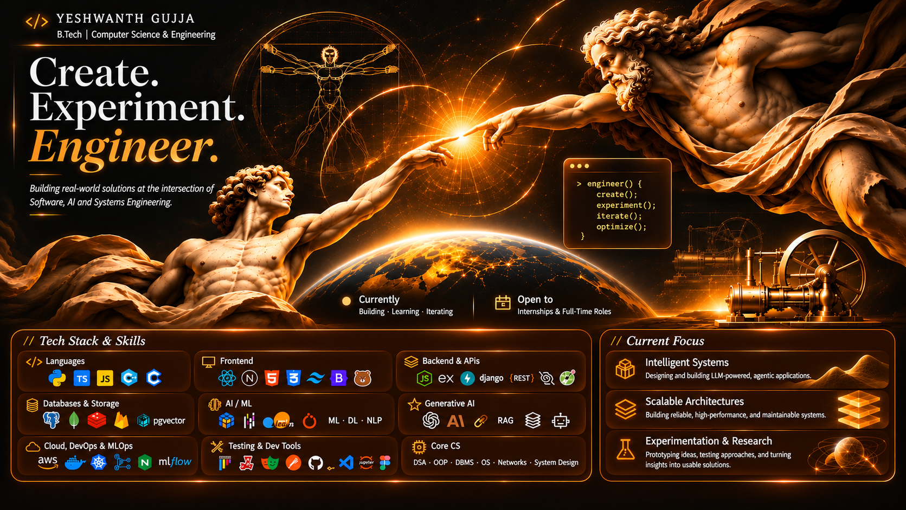

  

<h1 align="center">Create. Experiment. Engineer.</h1>

  <strong>YESHWANTH GUJJA</strong> 
  B.Tech · Computer Science &amp; Engineering  
  <strong>Building real-world solutions across software engineering, intelligent systems, and automation.</strong>

  
  

<h2>  &nbsp;</h2>I'm a Computer Science & Engineering student driven by the intersection of software engineering, intelligent systems, and practical problem-solving.

My approach to engineering goes beyond writing code. I focus on understanding how systems work, identifying the right technical approach, and translating ideas into reliable, functional solutions.

From application development and backend architecture to machine learning and agentic AI, I'm interested in exploring technologies that solve meaningful problems.
<h3>Engineering philosophy</h3><table>
  <tr>
    <td width="50%">
      <strong>🟠 Understand before building</strong> 
      Break down problems before choosing solutions.
    </td>
    <td width="50%">
      <strong>🟠 Experiment with intent</strong> 
      Explore technologies, validate assumptions, and learn through implementation.
    </td>
  </tr>
  <tr>
    <td width="50%">
      <strong>🟠 Engineer for reliability</strong> 
      Prioritize maintainability, performance, and sound technical decisions.
    </td>
    <td width="50%">
      <strong>🟠 Build continuously</strong> 
      Turn knowledge into practical projects and measurable progress.
    </td>
  </tr>
</table><h2> &nbsp; </h2>My technical interests span multiple layers of the software ecosystem.
Domain Engineering Focus
<strong>Software Engineering</strong> Maintainable applications, APIs, data structures, system design, and engineering fundamentals.
<strong>Full-Stack Development</strong> End-to-end web applications, modern frontend architectures, and backend integration.
<strong>AI & Machine Learning</strong> Applied ML, deep learning, NLP, model evaluation, and data-driven problem solving.
<strong>Generative AI & Agents</strong> LLM applications, RAG pipelines, embeddings, tool/function calling, and agentic workflows.
<strong>Automation & Infrastructure</strong> Developer workflows, browser automation, containers, CI/CD, and cloud services.

<h2> &nbsp;</h2>

  A working map of the languages, frameworks, platforms, and engineering tools across my technical landscape.

  
<strong>01 · Programming Languages</strong>

   
  

    
    
    
    
    
    
  

  
<strong>02 · Frontend Engineering</strong>

   
  

    
    
    
    
    
    
    
  

  
<strong>03 · Backend Engineering &amp; APIs</strong>

   
  

    
    
    
    
    
    
    
  

  
<strong>04 · Databases &amp; Storage</strong>

   
  

    
    
    
    
    
  

  
<strong>05 · Artificial Intelligence &amp; Machine Learning</strong>

   
  

    
    
    
    
    
    
    
    
    
  

  
<strong>06 · Generative AI &amp; Intelligent Systems</strong>

   
  

    
    
    
    
    
    
    
  

  
<strong>07 · Cloud, DevOps &amp; MLOps</strong>

   
  

    
    
    
    
    
    
  

  
<strong>08 · Testing &amp; Development Environment</strong>

   
  

    
    
    
    
    
    
    
    
    
    
  

  
<strong>09 · Computer Science Fundamentals</strong>

   
  

    
    
    
    
    
    
  

<h2> &nbsp;</h2>
The areas receiving my attention as I continue developing my engineering capabilities.
<table>
  <tr>
    <td width="8%" align="center"></td>
    <td>
      <strong>Intelligent Systems</strong> 
      Designing and building LLM-powered and agentic applications.
    </td>
  </tr>
  <tr>
    <td align="center"></td>
    <td>
      <strong>Scalable Architectures</strong> 
      Strengthening the ability to design reliable, maintainable, high-performance systems.
    </td>
  </tr>
  <tr>
    <td align="center"></td>
    <td>
      <strong>Experimentation &amp; Research</strong> 
      Prototyping ideas, evaluating approaches, and turning useful insights into working solutions.
    </td>
  </tr>
  <tr>
    <td align="center"></td>
    <td>
      <strong>Engineering for Impact</strong> 
      Applying technology and a systems mindset to practical problems.
    </td>
  </tr>
</table><h2> &nbsp;</h2>I'm open to connecting with developers, engineers, and people working on interesting technical problems.

  
  &nbsp;
  
  &nbsp;
  
  &nbsp;
  

  
  
  

  <strong><em>Curiosity starts the process. Experimentation sharpens it. Engineering makes it real.</em></strong>

